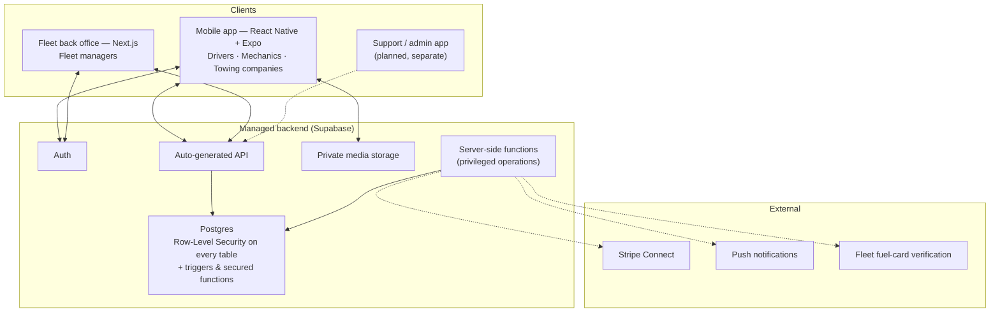
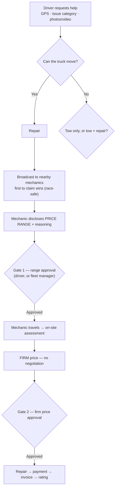

# SOTRUK — Case Study

**On-demand roadside repair and towing platform for the US trucking industry.** It connects truck drivers
with mobile mechanics and towing companies, and gives trucking companies (fleets) control over what their
drivers spend.

> **Client project.** The source code, database and data belong to the client and are not included here.
> This repository describes the architecture, the design decisions and my role, and nothing beyond that.

| | |
|---|---|
| **My role** | Software architect & technical lead: architecture, workflow and policy design, data/security model, delivery |
| **Deliverables** | Mobile app (iOS/Android) for drivers, mechanics and towing companies · web back office for fleet managers · database, security model and migrations · architecture and workflow documentation |
| **Stack** | React Native + Expo · Next.js · TypeScript · Supabase (Postgres, Auth, Storage) · Row-Level Security |
| **Scale of the build** | 26 mobile screens · 7 user roles · 16 tables · 24 versioned migrations · 6 UI languages |

---

## The problem

When a truck breaks down, the driver has to find a mechanic they've never met, agree a price at the
roadside, and often get permission from an employer before any work can start. Mechanics have an incentive
to raise the price once they're on site, and fleets have no visibility until the bill arrives.

## Architecture

**Key choices:**

- **Modular monolith on one managed backend.** No hand-built API server to host or patch. Dispatch, jobs,
  chat and payments are separate modules (groups of tables, rules and functions) inside one backend.
- **The database is the security boundary.** Access control lives in Postgres Row-Level Security and
  triggers, so a modified or malicious client still can't read or change data it shouldn't.
- **Privileged operations are server-only.** Anything that needs a secret, such as charging a card or
  recording a payment, can only happen in server-side functions. The app *cannot* mark a job as paid.
- **Relational over document storage.** The original brief named Firebase. I moved the design to
  Postgres because jobs, quotes, fleets and approvals need real integrity constraints.

## The job workflow

### Design decisions I made

| Decision | Why |
|---|---|
| **Two-gate pricing**: a range before the mechanic travels, then a firm price on site. **Negotiation removed** | Price certainty before anyone commits; takes away the "pay more or I stop" leverage mid-job |
| **Cancellation cost is determined by the last approved gate** | Objective and automatic, never a judgment call |
| **Fleet approval before every step, for every request, no dollar threshold** | For a fleet, approval decides *whether* a truck is serviced, not just what it costs. "Review the bill afterwards" was considered and rejected |
| **Fleet approval enforced in the database**, not only in the app | Testing proved an app-only version could be bypassed by a driver editing their own job |
| **Towing is its own role and its own service**, always priced separately from repairs | Towing is sometimes needed with no repair at all |
| **Tow + repair: find the shop and a ballpark price *before* towing** | A tow needs a real destination. A sight-unseen range from a shop mechanic costs nothing and gives the driver an early estimate |
| **The platform never estimates prices itself** (no AI estimates) | A confident wrong number at the roadside is a liability |
| **Three payment rails**: card (Stripe Connect), fleet fuel-card codes, fleet net-terms invoicing | Matches how US drivers actually pay; card-only would exclude many company drivers |
| **Payments and identity verification scheduled last** | Payments must respect a settled workflow, and gating dispatch on a verification process that didn't exist yet would have blocked all testing |
| **Fleets onboard themselves**: pending until reviewed, but they can invite drivers in the meantime | Removes manual setup; review still guards against fraud; nobody sits idle |
| **Drivers join a fleet only through single-use, expiring invite links** | Stops someone claiming fleet membership to get repairs paid for |
| **Escalation without trapping the driver**: a silent 15-minute clock, then a non-blocking "notify again" | Someone stranded at the roadside must always be able to use their phone |
| **Six UI languages** (EN, ES, PA, AR, RU, UK), type-checked so a missing translation fails the build | Reflects who actually drives trucks in the US |

## Security model

- **Row-Level Security on every table.** A driver sees only their own jobs, a mechanic sees the open pool
  plus their assigned jobs, and a fleet manager sees only their own fleet.
- **No self-promotion.** Users can't change their own role or fleet link. The only two exceptions (company
  registration and redeeming an invite) are narrow, audited database functions.
- **Protective triggers:** profile privilege guard, rating guard, fleet-approval gate guard and
  unapproved-fleet guard.
- **Race-safe job claiming:** two providers claiming the same job at once can't both win.
- **Every rule tested live** against the database using simulated sessions for each role, not just
  reviewed on paper.

### Issues caught before shipping (selection)

That live testing found real issues before any user did:

- The mechanic job-pool rule didn't check the viewer's role, so **any driver could see and claim another
  driver's job**. Fixed and regression-tested.
- Fleet approval was first enforced only in the UI, and **a driver could approve their own job** by
  editing it directly. That's why the database trigger exists.
- A permission check treated "unknown" values as truthy, so **an unrelated user could trigger a follow-up
  job on someone else's request**. Every check now treats unknown as "no".
- Two mutually-referencing security policies created a loop that made **every user's job list fail to
  load**. Rewritten with a secured helper function and verified live.
- An early draft let the app record payments directly. It was reverted before shipping, and payments stay
  server-only.

## Process

- **Architecture-first:** a Software Architecture Document and decision log (29 recorded decisions, each
  with its reasoning) came before the build and were kept current alongside it.
- **Versioned database migrations** in the repository, never ad-hoc console changes.
- **Hands-on smoke tests** of each flow on real devices and in the browser, with results checked against
  the database and findings written up (e.g. a raw deep link that messaging apps won't make tappable,
  and the default email provider's rate limit, which has to be replaced before launch).
- **AI-assisted implementation:** I owned the architecture, workflows, policies and review. Code was
  produced with AI pair-programming (Claude Code) against those specs, and each change was verified
  against the live database before it was marked done.

## Status

The core job lifecycle, towing, fleet approval and fleet self-onboarding run end-to-end on a real
backend. Payment processing (Stripe Connect), credential verification and app-store release are the
remaining milestones before public launch.
